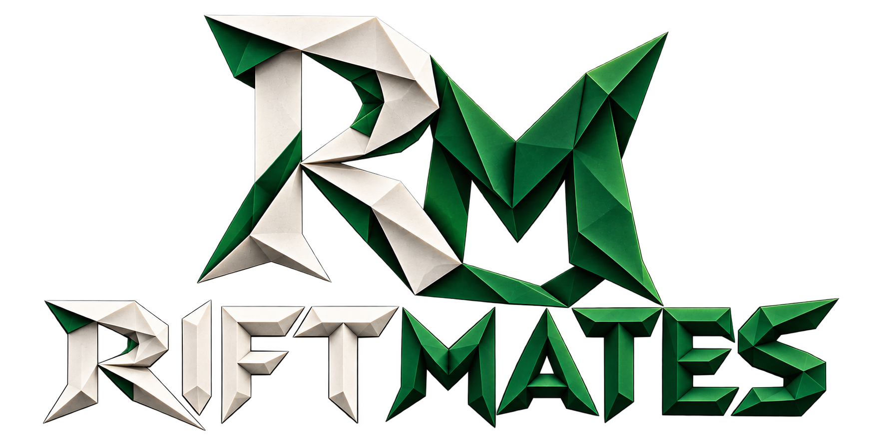
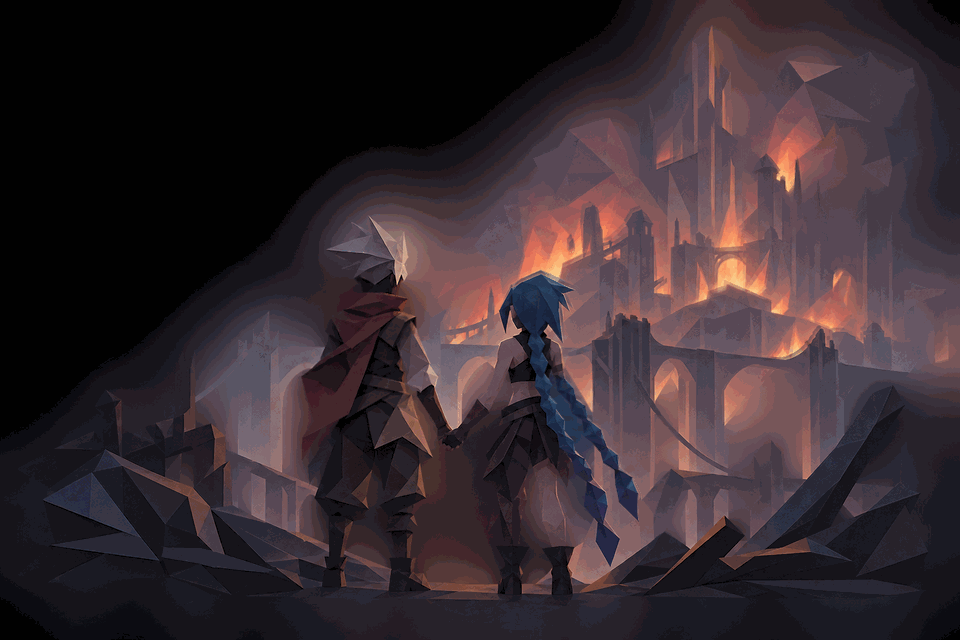
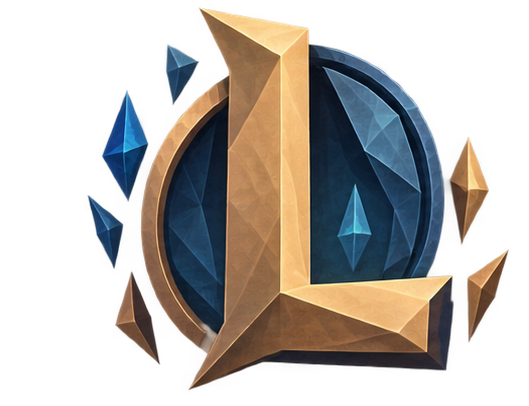
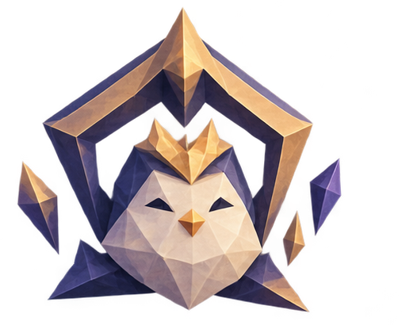
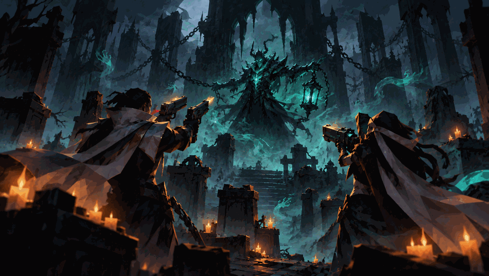
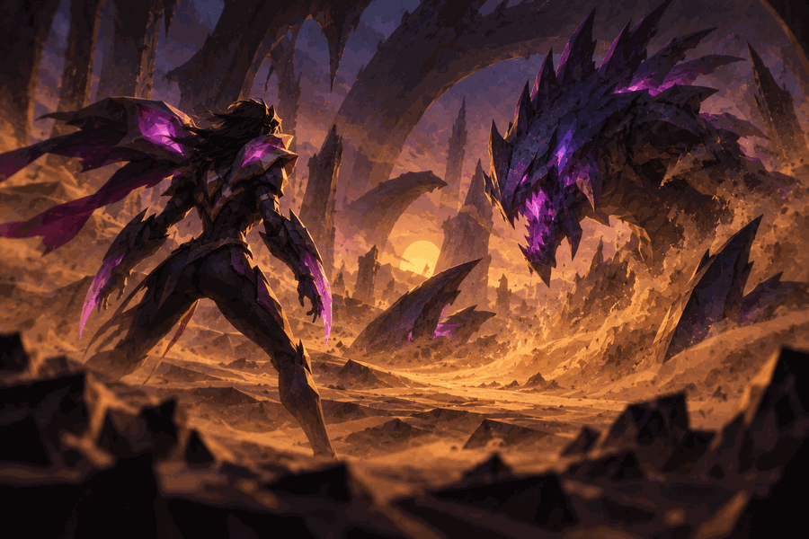
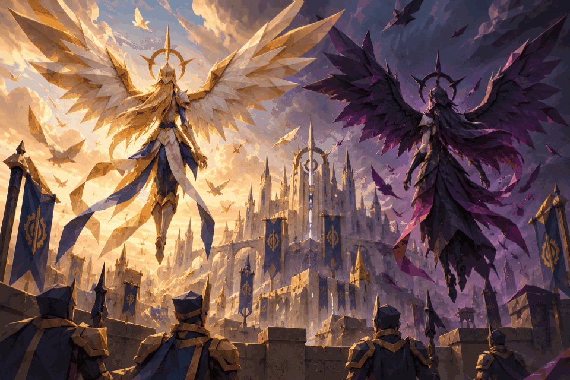
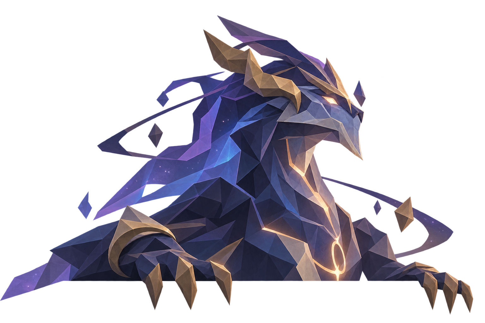

<div align="center">



# RIFTMATES

### Your squad. Your matches. Your story.

**A self-hosted League of Legends & Teamfight Tactics analytics dashboard**  
Track the people you play with, uncover your best combinations, and turn match history into squad intelligence.

   



*Made for the squad, powered by your actual match data.*

[Features](#-features) · [Quick start](#-quick-start) · [Run locally](#-running-riftmates-locally) · [Artwork](#-the-artwork)

</div>

---

## ✨ What is Riftmates?

Riftmates is a locally hosted web dashboard that uses Riot Games data to explore **how you and your friends perform individually and together**. It brings League of Legends and Teamfight Tactics into one interface, with player profiles, match history, rankings, team chemistry, and configurable analytics.

Rather than treating every number as a prediction, Riftmates helps you explore the **matches you've actually played**. Small samples and incomplete API data still matter—interpret results accordingly.

<table>
<tr>
<td width="50%" align="center"><h3>League of Legends</h3>Duos, champions, roles, draft analysis, match history and squad reports.</td>
<td width="50%" align="center"><h3>Teamfight Tactics</h3>Ranked and Double Up insights, placements, synergies and tier lists.</td>
</tr>
</table>

## 🎮 Features

### League of Legends

- **Squad HQ** — match awards, recent sessions, trends, achievements and player chemistry.
- **Players & roles** — individual profiles, role statistics and comparisons.
- **Duos & team combinations** — find the combinations that have performed best in synced games.
- **Champion, item & rune rankings** — explore performance and tier lists with filters.
- **Draft Lab** — explore draft options using your tracked players' historical performance.
- **Ranked progression** — follow player ranks and changes over time.
- **Match history & reports** — inspect match details, statistics and timelines where data is available.
- **1v1 Arena** — a *statistical comparison* of player performance, not a simulated in-game duel.

<div align="center"></div>

### Teamfight Tactics

- **Ranked & Double Up** — match and placement summaries for both queues.
- **Squad HQ** — a shared view of tracked players and recent matches.
- **Player profiles & ranked progression** — individual results and rank tracking.
- **Duos, synergies & team combinations** — compare shared matches and compositions.
- **Tier lists** — explore units, traits, items and augments using available match data.
- **Match history** — inspect units, items, star levels and placements when supplied by Riot's API.

<div align="center"></div>

### Personalization

- Editable tracked Riot accounts.
- Queue and match-count controls.
- Configurable analytics settings and player labels.
- Local SQLite-backed storage and JSON settings.
- Custom origami-themed interface, illustrations and ranked emblems.

## 🚀 Quick start

### Requirements

- Python 3 with `venv` support.
- A Riot Games API key with access to the endpoints used by the app.
- Internet access for Riot API requests.

### 1. Get the project

Clone the repository or download its ZIP, then enter the project directory:

```bash
cd Riftmates
```

### 2. Configure environment variables

Create a `.env` file in the project root:

```dotenv
RIOT_API_KEY=your_riot_api_key
RIOT_TFT_API_KEY=your_tft_api_key
RIOT_REGION=europe
PORT=8765
FLASK_SECRET_KEY=replace_with_a_long_random_secret
COOKIE_SECURE=0
```

`RIOT_API_KEY` is required. If `RIOT_TFT_API_KEY` is omitted, the backend falls back to the main Riot key. The TFT key may need additional API permissions for some endpoints.

**Never commit `.env`, API keys, session secrets or user databases to a public repository.**

### 3. Install and run

```bash
python3 -m venv .venv
source .venv/bin/activate
python -m pip install -r requirements.txt
python server.py
```

Open **http://127.0.0.1:8765** in your browser.

> The included `start.sh` is an alternative local launcher. It creates a virtual environment, installs requirements and starts `server.py`; it expects a `.env` file to exist.

## 💻 Running Riftmates locally

Riftmates runs directly on your computer using Python and a local web browser.

### macOS / Linux

From a terminal in the repository root:

```bash
# Create a Python virtual environment (first run only)
python3 -m venv .venv

# Activate it
source .venv/bin/activate

# Install dependencies
python -m pip install -r requirements.txt

# Start Riftmates
python server.py
```

Open **http://127.0.0.1:8765** in your browser.

On subsequent runs, activate the environment and start the server:

```bash
source .venv/bin/activate
python server.py
```

Alternatively, the repository includes a `start.sh` launcher:

```bash
chmod +x start.sh
./start.sh
```

The launcher expects your `.env` file to be configured first.

### Windows (PowerShell)

From PowerShell in the repository root:

```powershell
# Create a virtual environment
py -m venv .venv

# Install dependencies without activating the environment
.\.venv\Scripts\python.exe -m pip install -r requirements.txt

# Start Riftmates
.\.venv\Scripts\python.exe server.py
```

Then visit **http://127.0.0.1:8765**.

If `py` is unavailable, use `python` instead. Running the virtual environment's Python executable directly avoids PowerShell execution-policy issues.

### First-time setup

1. Create your `.env` file using the values shown in [Quick start](#-quick-start).
2. Start the application and open the local URL.
3. Add or edit the Riot accounts you want to track in the dashboard.
4. Run a sync to populate your local match data. The first sync can take longer because Riot API requests are rate-limited.

### Stopping and troubleshooting

Press **Ctrl+C** in the terminal running `server.py` to stop Riftmates.

If the page does not load, check that the terminal has no startup errors and that port `8765` is not already in use. If Python reports a missing module, ensure the dependencies were installed in the same `.venv` used to run the server. If Riot data is missing, verify your `.env` keys and their API permissions.

The development server is intended for local use.

## 📁 Repository layout

```text
Riftmates/
├── server.py                         # Flask API, Riot integration and analytics
├── riftmates.html                    # Dashboard UI, styles and browser scripts
├── requirements.txt                  # Python dependencies
├── start.sh                          # Local startup script
├── riftmates_analytics_settings.json # Bundled analytics settings
├── favicon.svg
├── decor/                            # Origami artwork and animations
├── rank_emblems/                     # SVG ranked emblems
└── .env                              # Local secrets (create yourself; do not commit)
```

The backend and frontend are currently largely single-file. A future modularization can separate routes, services, analytics, styles and JavaScript without changing the application's external behavior.

## 🎨 The artwork

Riftmates has its own collection of low-poly/origami-style illustrations, animated scenes, game logos and ranked emblems, stored in `decor/` and `rank_emblems/`.

<div align="center">
<table>
<tr><td></td><td></td></tr>
<tr><td></td><td></td></tr>
</table>
</div>

The images above reference **existing files in this repository**; no additional artwork is needed for the README to display them on GitHub.

## 🔒 Data, API and security notes

- Riftmates uses the Riot Games API; available data and endpoints depend on Riot's API policies and key permissions.
- The app stores local state in SQLite and JSON. Back up persistent files before upgrades or migrations.
- API data may be incomplete, delayed or based on small sample sizes; analytics are descriptive, not guarantees of future results.
- Riot Games and League of Legends / Teamfight Tactics are associated with Riot Games. Riftmates is an independent community project and is not endorsed by Riot Games.

---

<div align="center">


**Better together. Better with data.**

*Built for the squad.*
</div>
